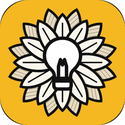
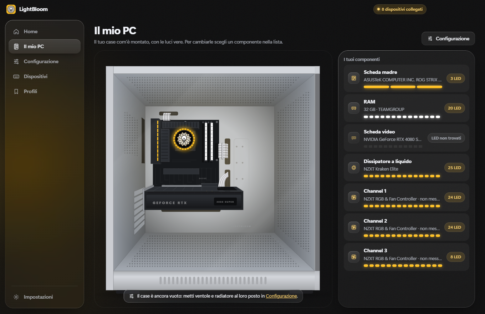
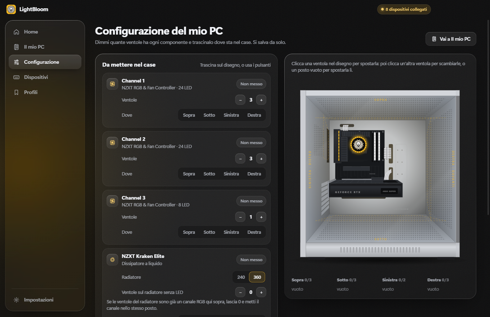
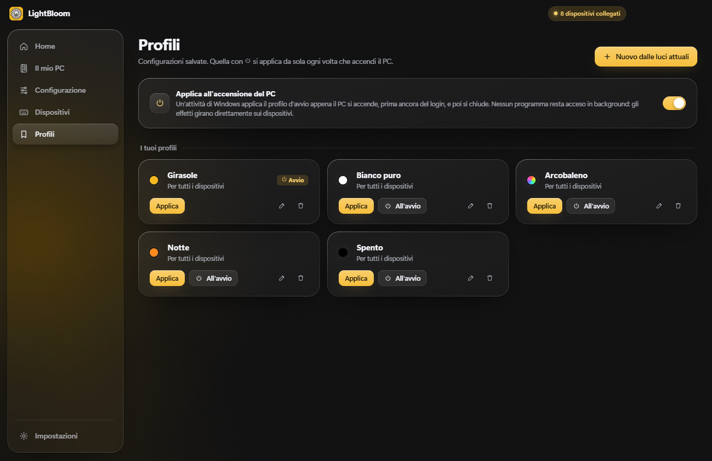

# LightBloom

**All the RGB lights of your PC — in one place.**

One light, calm app for Windows 10 and 11 that controls motherboard, RAM, fans, AIO coolers,
keyboards, mice and microphones together, with the dark glass look of the Bloom Suite.

---

## ✨ Highlights

| | |
|---|---|
| 💡 **Everything in one app** | Motherboard, RAM, AIO pump, fans, keyboard, mouse and microphone, without NZXT CAM, SignalRGB, iCUE or Armoury Crate. |
| 🖥️ **Your PC, drawn** | *My PC* draws your case with the real lights of each component. Click a part to change its colour, effect, brightness and speed. |
| 🧩 **Configuration** | Tell LightBloom where your fans and radiator are mounted (top, side, bottom, back) and move or swap them in one click. |
| ⌨️ **Devices** | Keyboards, mice and microphones get their own page, outside the case view. |
| 🎨 **Profiles** | Ready-made profiles (Sunflower, Pure white, Rainbow, Night, Off) plus your own. LightBloom remembers your last setup by itself. |
| 🔁 **Lights on at startup** | Your last configuration is applied when Windows starts, before you even log in, and every time you open the app. Close the window and LightBloom quits: only the tiny light engine keeps running (about 30 MB of RAM, ~0% CPU), so your lights stay exactly as you left them. Reopen it and it reconnects instantly, no rescan. |
| 🧰 **Drivers first** | The installer installs the PawnIO driver (RAM and motherboard lighting) **before** LightBloom, then the app and the OpenRGB engine — one setup for everything. |
| 🚦 **Conflict check** | Detects other RGB apps that lock your devices and closes them (and removes them from startup) in one click. |

## 📸 Screenshots

<table>
  <tr>
    <td>
<b>My PC</b>
</td>
    <td>
<b>Configuration</b>
</td>
  </tr>
  <tr>
    <td>
<b>Devices</b>
</td>
    <td>
<b>Profiles</b>
</td>
  </tr>
  <tr>
    <td colspan="2">
<b>Themes & settings</b>
</td>
  </tr>
</table>

Screenshots show the built-in demo PC.

## ⬇️ Install

1. Go to **[Releases](https://github.com/danielgrossi007-cpu/LightBloom/releases/latest)** and download **`LightBloom-Setup-x.y.z.exe`**.
2. Run it and allow administrator rights. Choose the install folder.
3. **Drivers first:** before LightBloom itself is copied, the installer shows a **Drivers** step and installs the
   **PawnIO** driver (needed for RAM and motherboard lighting). If it's already there, it's skipped.
4. Press **Install** to install LightBloom. Restart if Windows asks, then open **LightBloom** from the Desktop or the Start menu.
5. If LightBloom says another RGB app is open (NZXT CAM, SignalRGB…), press **Close and remove from startup**.

> Windows SmartScreen may warn you because the app isn't code-signed yet: click **More info → Run anyway**.

**Requirements:** Windows 10 or 11 (64-bit). Administrator rights are needed to reach RAM and motherboard lighting.

## 🔌 Supported hardware

LightBloom uses **[OpenRGB](https://openrgb.org)** as its hidden engine, so it supports the hundreds of devices OpenRGB supports:
NZXT Kraken / Hue 2 / RGB & Fan Controller, ENE-based RAM (T-Force Delta, and many more), ASUS Aura, MSI Mystic Light,
Gigabyte RGB Fusion and ASRock motherboards, many graphics cards, keyboards, mice and headsets.
See the [OpenRGB device list](https://openrgb.org/devices.html).

Devices that OpenRGB can't drive yet still show up, but their lights can only be changed by the maker's own software.

### ⌨️ Compatible keyboards

These keyboards are supported by the engine bundled with LightBloom (OpenRGB 1.1). Use them **wired** (or with their USB receiver) and close the maker's app first.

| Brand | Supported models (examples) |
|---|---|
| **Razer** | BlackWidow (Chroma, Elite, V3, V3 Mini/Pro/TKL, V4, V4 75%, V4 Pro, V4 TKL, V4 X), Huntsman (Elite, Mini, TE, V2, V2 TKL, V2 Analog, V3 Pro), Ornata (Chroma, V2, V3, V3 X, V3 TKL), Cynosa (Chroma, V2, Lite), DeathStalker V2 Pro TKL |
| **Corsair** | K55 RGB / PRO / PRO XT, K57, K60 RGB PRO (all versions), K65 (RGB, Mini, LUX, RAPIDFIRE), K68, K70 (RGB, LUX, MK.2, PRO, PRO V2, TKL, Core), K95 RGB / PLATINUM / XT, K100 |
| **Logitech** | G213, G813, G815, G915, G915 TKL |
| **SteelSeries** | Apex 3, Apex 3 TKL, Apex 5, Apex 7, Apex 7 TKL, Apex 9 Mini/TKL, Apex Pro, Apex Pro TKL (2023, Gen 3), Apex Pro 3, Apex M750 |
| **ASUS ROG** | Strix Scope (RX, TKL, NX, II, II RX, II 96), Falchion, Claymore |
| **HyperX** | Alloy Origins (Core, 60, 65), Alloy Elite RGB / Elite 2, Alloy FPS RGB |
| **Cooler Master** | CK530, CK550/CK552, MK730, MK750, MK850, SK620, SK622, SK630, SK650, SK652, SK653 |
| **Wooting** | One, Two, Two HE, 60HE / 60HE+ / 60HE v2, 80HE, UwU RGB |
| **Roccat / Turtle Beach** | Vulcan 100/120 Aimo, Vulcan Pro, Vulcan TKL / TKL Pro, Vulcan II (Max, Mini, TKL) |
| **Cherry** | MX Board 1.0 / 2.0S / 3.0S / 10.0 RGB, G80-3000 RGB, MV Board 3.0 RGB |
| **Ducky** | One 2 RGB, One 2 RGB TKL, Shine 7 |
| **Keychron** | Models running **QMK/ZMK** firmware with RGB (“Keychron RGB QMK/ZMK Keyboard”) |
| **Others** | Das Keyboard Q4/Q5/Q5S, EVGA Z15/Z20, Lenovo Legion K500/K510, XPG Summoner, Cougar 700K EVO, Fnatic Streak65, HYTE Keeb TKL, Red Square Keyrox TKL, Valkyrie VK99, Skyloong GK104 Pro, many EVision/Sonix-based keyboards (e.g. several Redragon models) |

> ⚠️ **Generic "no-name" keyboards** that identify themselves only as *USB DEVICE* (often with the Apple ID `05AC:024F`) may be
> detected but **can't be controlled**: Windows locks their lighting channel. Full, always up-to-date list:
> [OpenRGB supported devices](https://openrgb.org/devices.html).

## 🌸 Part of the Bloom Suite

LightBloom is part of the **Bloom Suite**, together with [HealthBloom](https://github.com/danielgrossi007-cpu/HealthBloom):
a family of Windows apps that share one look — a white glyph with a bold black outline at the heart of an engraved flower,
on a solid colour tile.

## 🔒 Privacy

Everything runs locally on your PC. No accounts, no telemetry, no internet needed.

## 📄 Third-party software

LightBloom ships **OpenRGB** (GPL-2.0) as a separate program and the **PawnIO** driver installer.
Details and source links are in [THIRD-PARTY.md](THIRD-PARTY.md).

---

© 2026 Daniel · LightBloom · All rights reserved. The LightBloom source code is not public; bundled third-party components keep their own licenses.

