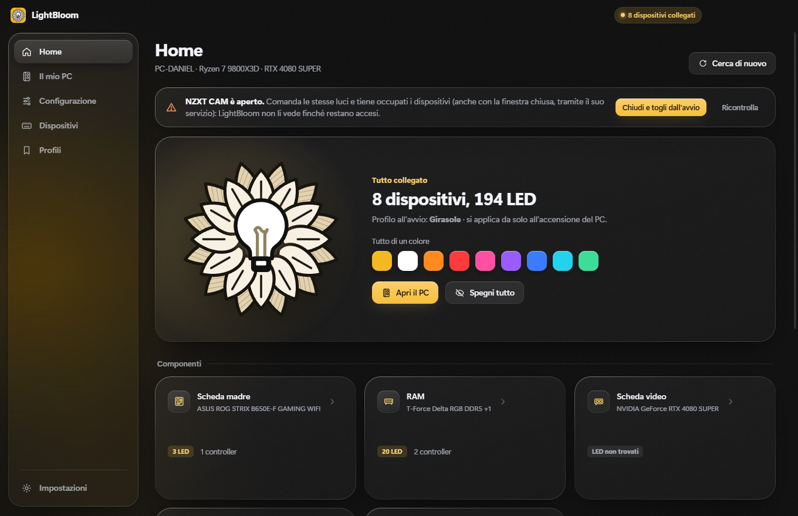
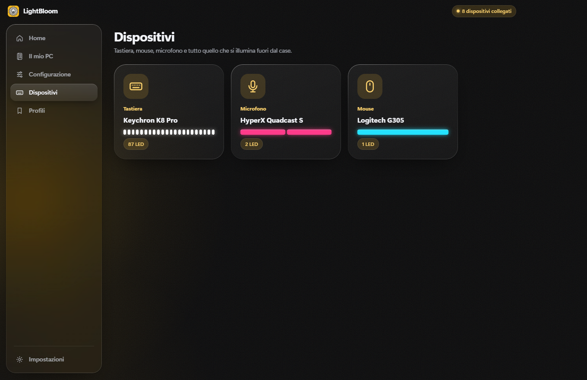
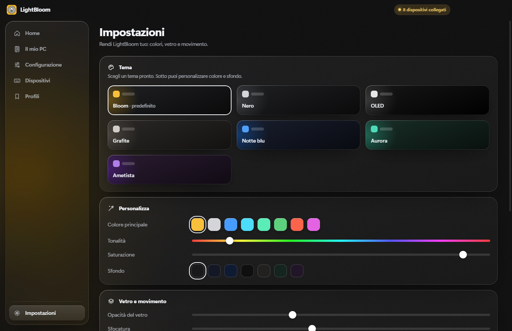

# LightBloom

**All the RGB lights of your PC — in one place.**

One light, calm app for Windows 10 and 11 that controls motherboard, RAM, fans, AIO coolers,
keyboards, mice and microphones together, with the dark glass look of the Bloom Suite.

---

## ✨ Highlights

| | |
|---|---|
| 💡 **Everything in one app** | Motherboard, RAM, AIO pump, fans, keyboard, mouse and microphone, without NZXT CAM, SignalRGB, iCUE or Armoury Crate. |
| 🖥️ **Your PC, drawn** | *My PC* draws your case with the real lights of each component. Click a part to change its colour, effect, brightness and speed. |
| 🧩 **Configuration** | Tell LightBloom where your fans and radiator are mounted (top, side, bottom, back) and move or swap them in one click. |
| ⌨️ **Devices** | Keyboards, mice and microphones get their own page, outside the case view. |
| 🎨 **Profiles** | Ready-made profiles (Sunflower, Pure white, Rainbow, Night, Off) plus your own. LightBloom remembers your last setup by itself. |
| 🔁 **Lights on at startup** | Your last configuration is applied when Windows starts and every time you open the app. The engine stays in the tray using about 0.1% CPU and ~30 MB of RAM. |
| 🧰 **Drivers included** | The installer sets up everything: the app, the OpenRGB engine and the PawnIO driver needed for RAM and motherboard lighting. |
| 🚦 **Conflict check** | Detects other RGB apps that lock your devices and closes them (and removes them from startup) in one click. |

## 📸 Screenshots

<table>
  <tr>
    <td>
<b>My PC</b>
</td>
    <td>
<b>Configuration</b>
</td>
  </tr>
  <tr>
    <td>
<b>Devices</b>
</td>
    <td>
<b>Profiles</b>
</td>
  </tr>
  <tr>
    <td colspan="2">
<b>Themes & settings</b>
</td>
  </tr>
</table>

Screenshots show the built-in demo PC.

## ⬇️ Install

1. Go to **[Releases](https://github.com/danielgrossi007-cpu/LightBloom/releases/latest)** and download **`LightBloom-Setup-x.y.z.exe`**.
2. Run it, allow administrator rights and follow the installer. It also installs the PawnIO driver if it's missing.
3. Restart if Windows asks, then open **LightBloom** from the Desktop or the Start menu.
4. If LightBloom says another RGB app is open (NZXT CAM, SignalRGB…), press **Close and remove from startup**.

> Windows SmartScreen may warn you because the app isn't code-signed yet: click **More info → Run anyway**.

**Requirements:** Windows 10 or 11 (64-bit). Administrator rights are needed to reach RAM and motherboard lighting.

## 🔌 Supported hardware

LightBloom uses **[OpenRGB](https://openrgb.org)** as its hidden engine, so it supports the hundreds of devices OpenRGB supports:
NZXT Kraken / Hue 2 / RGB & Fan Controller, ENE-based RAM (T-Force Delta, and many more), ASUS Aura, MSI Mystic Light,
Gigabyte RGB Fusion and ASRock motherboards, many graphics cards, keyboards, mice and headsets.
See the [OpenRGB device list](https://openrgb.org/devices.html).

Devices that OpenRGB can't drive yet still show up, but their lights can only be changed by the maker's own software.

## 🌸 Part of the Bloom Suite

LightBloom is part of the **Bloom Suite**, together with [HealthBloom](https://github.com/danielgrossi007-cpu/HealthBloom):
a family of Windows apps that share one look — a white glyph with a bold black outline at the heart of an engraved flower,
on a solid colour tile.

## 🔒 Privacy

Everything runs locally on your PC. No accounts, no telemetry, no internet needed.

## 📄 Third-party software

LightBloom ships **OpenRGB** (GPL-2.0) as a separate program and the **PawnIO** driver installer.
Details and source links are in [THIRD-PARTY.md](THIRD-PARTY.md).

---

© 2026 Daniel · LightBloom · All rights reserved. The LightBloom source code is not public; bundled third-party components keep their own licenses.

